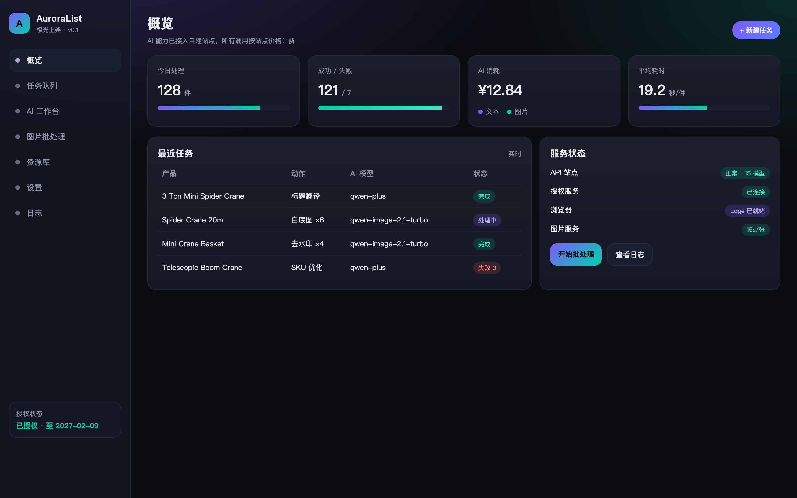

# 设计稿 · AuroraList（极光上架）

## 一、产品定位

> 一句话：**给跨境电商卖家的 AI 上架工作台** —— 采集、翻译、做图、定价、发布，一条流水线跑完。

- 软件名：**AuroraList**（中文：极光上架）
- 目标用户：速卖通/TikTok Shop 中小卖家
- 核心差异：AI 原生 + 批量流水线 + 全链路可观测

## 二、信息架构（对齐老软件真实功能）

```
AuroraList
├── 概览 Dashboard
│   ├── 今日处理 / 成功 / 失败 / AI 消耗
│   ├── 服务状态（API / 授权 / 浏览器 / 图片服务）
│   └── 最近任务
├── 店铺与模板 Store
│   ├── 浏览器窗口（本机Edge / 比特 / 站斧）
│   ├── 店铺绑定（名称 + 店铺ID + 刷新）
│   ├── 产品模板（选择 / 保存 / 更多）
│   └── 分类策略（模板分类 / 自动分类）
├── AI 智能填写 AI Writer
│   ├── 标题生成（提示词 + 开关）
│   ├── 详情描述（提示词 + 开关）
│   ├── SKU 优化（提示词 + 开关）
│   └── 读图估算重量规格（提示词 + 包装重量策略）
├── 内容审查 Review
│   ├── 详情文本审查 / 详情图审查 / 主图审查
│   └── 自定义审查规则
├── 图片处理 Images
│   ├── 简单编辑：白底图 / 去水印（范围 + 开关）
│   ├── 通用编辑：提示词 + 参考图（1-2 张）
│   ├── 背景生成：位置规则表 + 模型
│   └── 批处理工作台（选品 → 批量跑图 → 结果）
├── 价格与变种 Pricing
│   ├── 价格模式（倍率 / 包邮）
│   ├── 分区倍率 / 倍率 / 固定加价
│   ├── 区域调价模板（搜索 + 应用）
│   └── 变种映射（自动 / 手动，属性对照表）
├── 设置 Settings
│   ├── 验证与授权（店铺 / 本地；设备ID；校验）
│   ├── 通用设置（上传分类 / 营销白底图）
│   └── API 与模型
└── 日志 Logs（实时 / 历史 / 导出）
```

## 三、视觉规范

| 项 | 值 |
|---|---|
| 主色 | `#7C5CFF` → `#00D2A8` 渐变（极光） |
| 背景 | `#0B0D12` / 卡片 `#141824` / 悬浮 `#1B2030` |
| 文字 | 主 `#E8EAF2` / 次 `#8B92A8` |
| 圆角 | 卡片 16 / 按钮 12 / 输入 10 |
| 字体 | Inter + 思源黑体 |
| 动效 | 200ms ease-out，页面切换淡入 |

## 四、关键界面



> 说明：AI 工作台与概览共用同一套侧边栏 + 卡片体系，只是内容区不同。

## 五、功能-模块对照（重构版）

| 界面 | 服务模块 | 状态 |
|---|---|---|
| Dashboard | `services.stats` | 待建 |
| AI 文本 | `services.TextService` | ✅ |
| AI 图片 | `services.ImageService` | ✅ |
| 设置 | `config.AppConfig` | ✅ |
| 任务 | `services.BatchRunner` | ✅ 基础 |
| 日志 | `core.logger` | ✅ |
| 授权 | `license` | ✅ |
| 采集/发布 | `services.publisher` | P1 |

## 六、技术栈

- UI：Flet（Python，跨平台，可打包 exe）
- 网络：requests（OpenAI 兼容接口）
- 打包：PyInstaller + Inno Setup（Windows）
- CI：GitHub Actions（windows-latest）
