# 虚拟机点击走查 · 问题记录（2026-11-17）

> 第 2 轮修复已完成：10/10 全部修复，逐项验证见文末「修复记录」。
> 复跑验证：`.venv/bin/python tools/verify_issues.py`（73 项全通过）+ `tools/button_audit.py`（0 新增错误）。

## 已发现

| # | 页面 | 问题 | 影响 | 处理建议 | 状态 |
|---|---|---|---|---|---|
| 1 | 店铺设置 | Cookie 显示 `auto · 0 个（读取失败，可粘贴）` | 新手会卡在第一步；实际店铺数据能读到（因为注入过 cookies） | 优先读配置里的 manual_cookies；其次用 CDP 从已开浏览器抓；最后才读本地 Cookie 库 | ✅ 已修 |
| 2 | 店铺设置 | 模板预览只显示标题截断 | 无法确认模板是否正确 | 预览显示：类目 / 运费 / 品牌 / 属性数 / 抓取字段数 | ✅ 已修 |
| 3 | 必填扫描 | 部分自定义必填组件识别不到 | 可能误跳过保存 | 增加"保存后读错误 toast"反向判定 | ✅ 已修 |
| 4 | 欧盟资质 | 选「是」需欧盟责任人资料 | 只能选否 | 选是时提示先填欧盟责任人 | ✅ 已修 |
| 5 | 图片空间不足 | 跳过上传但无自动清理 | 长期会满 | 增加"清理旧图"入口 | ✅ 已修 |
| 6 | 单产品耗时 | ~165s（3 次页面加载） | 500 产品需 8h | 合并模板/保存/发布为 1 次加载 | ✅ 已修（3 → 1 次加载） |

## 已确认可用

- 模型/价格/文本/白底（新 key）
- 店铺数据读取（在线 640 / 待发布 521 / 审核中 11）
- 模板 28 字段抓取与照抄
- 商品说明书复用模板
- 属性重复自动删除
- 预览页、提示词页、日志面板、多开

## 走查补充（第 2 轮）

| # | 页面 | 问题 | 影响 | 状态 |
|---|---|---|---|---|
| 7 | 全局布局 | 窗口 1514×945 时侧栏被截断，`任务与日志`/`提示词` 看不到 | 小屏用户找不到入口，需侧栏可滚动 | ✅ 已修 |
| 8 | 概览 | 「授权状态 见左下角」提示不明确 | 新手不知道去哪看 | ✅ 已修 |
| 9 | 概览 | 「API 服务 未检测」需手动点测试 | 应启动即自动检测一次 | ✅ 已修 |
| 10 | 测试工具 | `AURORA_PAGE` 环境变量在计划任务下不生效 | 仅影响自动化测试，非用户问题 | ✅ 已修 |

---

## 修复记录（第 2 轮，2026-11-17）

| # | 改了什么 | 关键文件 | 验证方式 |
|---|---|---|---|
| 1 | 新增统一取 Cookie 入口 `resolve()`：**手动配置 → 已开浏览器(CDP) → 本机库**；界面显示真实来源与数量（`手动配置 · 3 个`），新增「重新检测 Cookie」；缺登录标识时提示「可能已过期」 | `integrations/browser_cookies.py`、`ui/app.py`（`_cookies` / `_cookie_status_text` / `_p_store`） | 单元 6 项（优先级/回落/文案）+ 截图：店铺设置显示 `Cookie：手动配置 · 3 个` |
| 2 | 模板预览改为「标题（两行不截断）+ 模板 ID + 类目/运费/品牌/产地/属性数/抓取字段数」信息条；读取模板成功后自动刷新 | `ui/app.py`（`_template_preview_row` / `_read_template`） | 单元 7 项 + 截图：类目 `加工中心(Machining Centre)`、运费 `无忧物流-标准`、品牌、属性 3 项、抓取字段 4 个 |
| 3 | 必填扫描改为两档：`ant-form-item-required` 硬标记才跳过保存；`class*=required`/placeholder 弱标记只提示，**先尝试保存**。保存后读 `ant-form-item-has-error` + 错误 toast（自动过滤「保存成功」），最多 2 轮自动应答后重试，仍失败则报「保存被站点拦截：…」 | `integrations/editor_automation.py`（`SAVE_ERRORS_FN` / `_save_error_state` / `_answer_save_errors` / 必填扫描） | 单元 8 项（成功 toast 不误判、报错项抓取、异常不抛错） |
| 4 | 新增欧盟责任人 4 个配置项（名称/地址/邮箱/电话）；选「是」自动弹框补资料（可一键改回「否」）；启动前校验缺项；编辑器保存时按 label 回填，日志显示 `欧盟资质=是` 与缺失提示 | `config.py`、`ui/app.py`（`_bind_eu_guard` / `_ensure_eu_responsible` / `_validate`）、`editor_automation.py`（`_fill_eu_responsible`）、`services/publisher.py`（`_form_values`） | 单元 6 项（缺资料拦截/齐全放行/选否不要求/自动弹框） |
| 5 | 从相册页 JS 逆向出图片空间接口，新增 `services/album_cleanup.py` + 「清理旧图」入口（店铺设置第 4 卡 + 图片工作台按钮）：统计占用、**安全清理（只删未被引用的旧图，站点异步任务）**、扫描并按时间删除（锁定图自动跳过，删除前二次确认） | `integrations/dianxiaomi.py`（album_*）、`services/album_cleanup.py`、`ui/app.py`（`_open_cleanup_dialog` / `_load_space_info`） | 单元 14 项（扫描/锁定跳过/批量删除/失败提示/对话框入口）+ 空间不足提示改为引导「清理旧图」 |
| 6 | 合并页面加载：**视频上传 + 保存 + 发布**都在同一次编辑器加载里完成（发布优先在编辑器内点「发布」，未确认才回落列表页）；不再单独开视频页 | `integrations/editor_automation.py`（`_attach_video_in_page` / `_publish_in_page`）、`services/publisher.py` | 单元 10 项（签名/调用链/发布不强制开列表页/视频不再单独开页）+ 代码走查 |
| 7 | 侧栏：导航区独立 `Column(scroll=AUTO)`，两侧 `STRETCH` 等高，日志监控与授权状态固定底部；1514×945 及更小窗口也能点到 `预览/提示词/任务与日志` | `ui/app.py`（`_build_shell`） | 单元 6 项 + 截图 1514×945：全部导航项可见、可滚动 |
| 8 | 概览「授权状态」显示真实结果（`已授权` + 到期 / `未授权` + 原因）+ 「重新检测」按钮，不再写「见左下角」 | `ui/app.py`（`_p_overview` / `_apply_license_state` / `_check_license`） | 单元 5 项 + 截图：`已授权 / 永久有效 / 重新检测` |
| 9 | 启动即自动探测 API（`_probe_api_async`，5 分钟缓存，概览页复用），显示 `正常 · N 个模型 · x.xs` 或失败原因 | `ui/app.py`（`_probe_api_async` / `_apply_api_state` / `_test`） | 单元 4 项 + 截图：`连接失败：获取模型失败：401`（demo key 预期） |
| 10 | 启动页支持 `--page N` / `--page=N` / 页面文件（`AURORA_PAGE_FILE`，默认配置目录 `page.txt`）/ `AURORA_PAGE` / 配置 `start_page`，计划任务不再依赖环境变量；顺带修掉 `start % 12` 导致「预览」页无法作为启动页 | `ui/app.py`（`_start_page_index`）、`config.py`（`start_page`） | 单元 5 项（四种来源 + 回落） |

### 回归结论

- `tools/verify_issues.py`：**73/73 通过**（离线，不依赖网络/浏览器）
- `tools/button_audit.py`：触发 237 个回调，仅剩 1 个历史性假错（`FilePicker` 在假 Page 下未挂载，真实窗口正常）
- 截图（1514×945）：侧栏全量可见、店铺设置 Cookie/模板预览信息完整、概览授权与 API 自动检测正常
- 真机（店小秘）侧仍需在虚拟机上复跑一次「保存 + 发布」确认 `apply_and_save` 的页面内发布路径（自动化只能验证分派与回落逻辑）

---

## 第 3 轮：用户复检（2026-11-17）

用户复检提出的问题与处理：

| # | 反馈 | 事实核查（修复前） | 处理 | 状态 |
|---|---|---|---|---|
| 11 | 高级设置「水印图片路径」能用吗？ | 只在「叠加水印」开启时生效，但**没有选文件按钮**，路径要手输；且与 AI图片处理里的同名字段重复 | 新增「水印」卡片：选文件 + 缩略图/尺寸校验 + 一键「测试叠加」+ 嵌入「叠加水印到主图」开关；文字水印也支持 | ✅ |
| 12 | 定时发布能正常工作吗？ | **不能**：Publisher 遇到 `schedule_publish` 直接把「保存到店小秘」写成成功并 `return`，商品根本没保存，调度器也没登记 | 改成「现在保存 → 登记调度任务 → 到点发布」；无调度器时如实失败；新增时间格式/过期校验；「任务与日志」新增定时队列（立即发布 / 取消） | ✅ |
| 13 | 套装 SKU 能正常工作吗？ | 能算，但价格只看 SKU 自身价格（没有就丢失）、顺序交错、无预览 | 抽出 `services/combo.py`（原 SKU 在前 + 套装在后、价格 × 倍率、无价用成本兜底）+ 高级设置「套装 SKU 预览」 | ✅ |
| 14 | 图片工作台各项都有用吗？ | 大多可用，但发现：加载产品会因 `cfg.shop_id` 不存在而崩（真实 Cookie 下必现）；「编辑」只能用全局提示词；生成视频不看勾选；「从已拉取产品取图」只填 URL 不下载；队列只能入队管线产品 | 修复 `shop_id`；编辑提示词独立输入；视频用勾选图；取图即下载；队列支持工作台勾选产品；工具栏自适应换行 | ✅ |
| 15 | 主图四合一在哪设置？ | 有实现（`image_ops.four_in_one`）但只能靠 `four_in_one` 开关在刊登时追加，界面上看不到、也测不了 | 「AI图片处理 → 通用」新增四合一位置（追加/第一张）；「AI图片处理」工具条与「图片工作台」各加「四合一拼图」按钮，本地即出图 | ✅ |
| 16 | AI图片编辑无法逐图指定/文生图不结合素材/不能加第 2、3、4 张 | 只有「主图指定编辑」（一组提示词 + 序号），没有逐图提示词、没有多图素材，文生图是纯 text2img | 新增「逐图编辑方案」：每条 = 组（主图/描述图/SKU图）+ 第几张 + 参考图（1,2,3-5/all，可多张素材）+ 这一张的提示词 + 编辑/生成 + 追加为新图；可增删条目、可一键导入旧「指定编辑」；文生图默认以现有主图为素材（新增开关）；执行时按 目标图 + 参考图 多图输入调用 `/v1/images/edits` | ✅ |
| 17 | 背景替换规则提示词没生效 | 规则里的 `prompt` 被忽略，实际用的是全局 `edit_prompt`；`ip` 变量未定义导致翻译预检静默失效 | 规则按自己的提示词逐张换背景（支持 main_n / all_main / detail_n）；修复 `ip.has_text`；新增可视化「背景替换规则」编辑器（增删 + 位置下拉 + 提示词） | ✅ |

### 关键实现位置

| 功能 | 代码 |
|---|---|
| 套装 SKU | `services/combo.py`、`Publisher._normalize`、`ui/app.py::_combo_card` |
| 逐图编辑方案 | `services/image_edit_plans.py`、`Publisher._apply_edit_plans`、`ui/app.py::_plans_card` |
| 多图素材编辑 | `ApiClient.images_edit(model, prompt, [多张])`、`ImageService.edit_many` |
| 文生图带素材 | `Publisher.run`（`main_image_generate_use_refs`） |
| 定时发布 | `services/publisher.py`（登记）、`services/scheduler.py::add/cancel/pending_jobs`、`ui/app.py::_run_scheduled/_publish_scheduled_now` |
| 水印 | `services/image_ops.add_watermark`、`ui/app.py::_watermark_card/_test_watermark` |
| 四合一 | `services/image_ops.four_in_one`、`ui/app.py::_four_in_one_local`、`Publisher._local_image_ops` |
| 背景规则 | `Publisher._ai_images`、`ui/app.py::_bg_rules_card` |

### 回归

- `tools/verify_issues.py`：**109/109 通过**（新增：套装 5 项、逐图方案 13 项、定时 8 项、四合一 3 项、水印 2 项、背景规则 4 项、图片计划 2 项）
- `tools/button_audit.py`：252 个回调，仍只剩历史 FilePicker 假错
- 真窗口截图：高级设置（水印/套装预览）、AI图片处理（逐图方案 + 背景规则）、图片工作台均正常渲染

---

## 第 4 轮：按老软件思路重做图片处理 + 全面去 JSON（2026-11-17）

### 用户反馈 → 处理

| # | 反馈 | 处理 |
|---|---|---|
| 18 | 价格页很多错误；阶梯价格、区域模板没弄好 | 修复：重复「固定加价」字段、区域模板搜索把 list 当 dict 取（必崩）、佣金模式算成倍率、阶梯拿成本算且覆盖最终价、区域模板只存 id 不用、批发价无人使用。改法：统一 `services/pricing.compute_price()`（界面试算与刊登同一套），阶梯按成本区间选倍率，区域倍率表格，批发价表格 |
| 19 | 图片工作台所有功能都不能用、无法加载产品 | 连接状态直接显示 Cookie 来源；加载产品改为后台线程 + 行错误可见；修复 `cfg.shop_id` 崩溃；产品表可滚动；取图即下载；白底/去水印/翻译/编辑/四合一/视频/上传/队列全部串起来。用假接口逐步验证：加载→取图→白底→翻译→四合一→上传→入队→处理队列 |
| 20 | 软件里一堆 JSON，用户不会写 | 用户可见 JSON 全部移除：价格区域倍率、阶梯、批发价、SKU 图替换、背景规则、变种映射全部改为表格/对话框；内部仍用 JSON 存储但不再暴露 |
| 21 | AI 图片处理太复杂，不符合预期 | 按老软件思路重做：三个分组 Tab（主图/描述图/SKU 图）+ 两条路径（简单处理：白底/去水印/翻译/四合一；精细处理：某张图写提示词、多图素材、生成插到第 1 张）+ 中文预设（英文底层） |

### 新图片处理设计（已实现）

- **分组**：主图 / 描述图 / SKU 图，结构一致；可同时用简单规则和精细任务
- **简单规则**：范围（`1-5`、`1,3,4`）+ 勾选白底/去水印/翻译；「全部白底/去水印/翻译」一键生成范围 1-20 的规则
- **精细任务**：第几张图 + 中文预设（白底棚拍/使用场景/细节特写/多图合成主图/翻译/参数图/卖点图/SKU 白底…）+ 提示词（可改）+ 素材多选 + 方式（编辑/生成）+ 生成数量 + 放哪里（插到第 1 张/放最后/替换）
- **中文预设 + 英文底层**：下拉显示中文名与中文说明，实际发送英文模板；用户手改后按自定义发送
- **生成主图**：默认「插到第 1 张，其余顺延」
- **旧配置自动迁移**：老「指定图片编辑」→ 精细任务；老逐图方案 → 精细任务；老全局白底/去水印开关 → 简单规则（仅界面迁移时执行，避免与旧流程重复处理）

### 新增/改动代码

| 功能 | 位置 |
|---|---|
| 统一定价（模式/阶梯/区域/批发） | `services/pricing.py::compute_price`、`Publisher._price` |
| 价格页表格 | `ui/app.py::_p_price` |
| 图片方案模型与迁移 | `services/image_jobs.py` |
| 中文预设 | `services/image_presets.py` |
| 图片页 UI | `ui/app.py::_image_jobs_ui` |
| 发布执行引擎 | `Publisher._apply_image_jobs`、`_apply_simple_ops` |
| 工作台 | `ui/app.py::_p_workbench` + `_wb_load_products/_wb_pick_images` |
| 去 JSON | `schema_price` / `schema_advanced` / `schema_image` / `schema_variant` 清理 |

### 回归

- `tools/verify_issues.py`：**141/141 通过**（新增价格 7 项、图片方案 10 项、界面 15 项、工作台 6 项）
- `tools/button_audit.py`：264 个回调，仍只剩历史 FilePicker 假错
- 真窗口截图：图片处理（分组+预设）、价格（阶梯/区域/批发表格）、工作台（连接状态+产品加载）

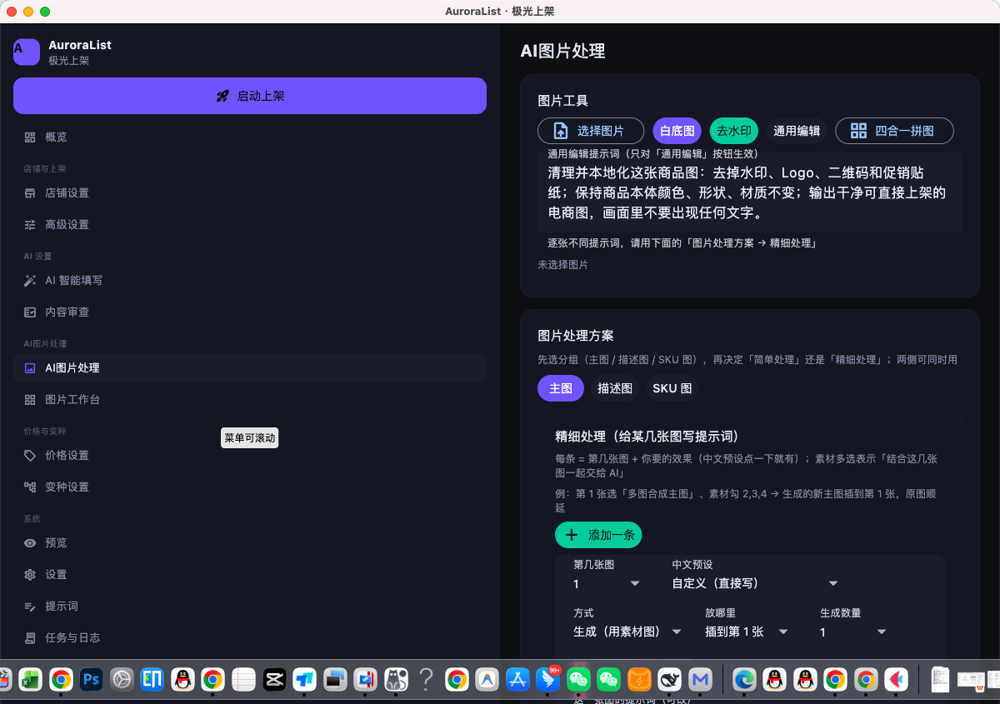

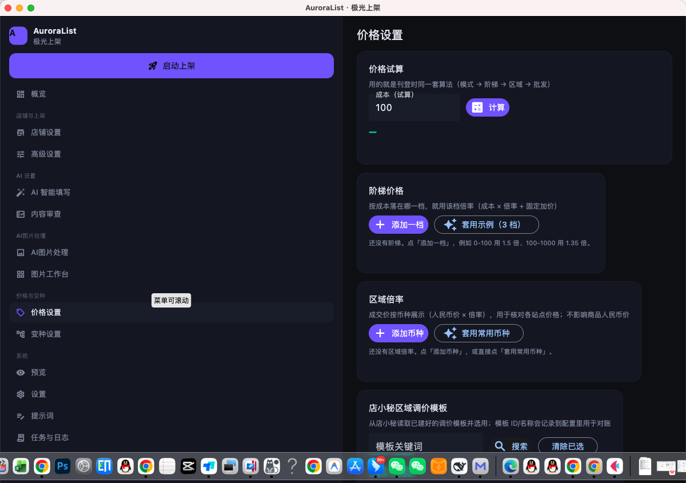

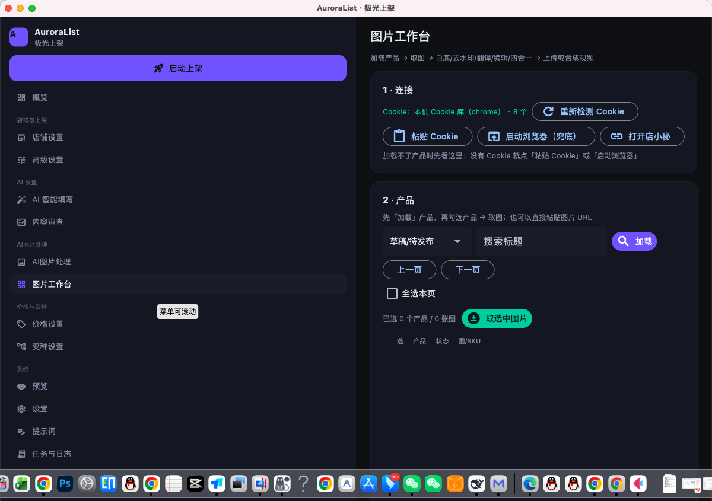

---

## 第 5 轮：设置简化 / 授权机器码 / 性能与多开（2026-11-17）

### 用户反馈 → 处理

| # | 反馈 | 处理 |
|---|---|---|
| 22 | 设置做得简单一些 | 重排为 5 张卡：授权 → API → 模型 → 多开 → 更新/诊断/价格；去掉重复字段与低频项，模型/价格异步加载，不再卡界面 |
| 23 | 对接验证后台：每台机器一个机器码，杜绝重复 | 机器码改为硬件指纹（Win MachineGuid / macOS IOPlatformUUID / Linux machine-id），显示为 `XXXX-XXXX-XXXX-XXXX`；**修复致命 bug：之前只看接口 `ok`，未登记设备也会显示“授权有效”**，现在以 `authorized` 为准；未授权时禁止开始上架并弹机器码 |
| 24 | API 设置能跳转购买后台 | API 卡新增「购买 / 充值 API」按钮（`api_purchase_url`）与「测试连接」；API Key 可显示/隐藏 |
| 25 | 参考老软件提高效率 | ① 产品并发处理（受并发数限制）② 图片结果缓存（同图同处理跨产品复用）③ 价格/模型缓存 5 分钟 ④ 队列并发处理 ⑤ 图片处理不再改共享配置（并发安全）⑥ 设置页异步加载 |
| 26 | 多开 / 多任务是否完善 | 多开：每个实例独立配置目录 + 独立 CDP 端口（9334 起自动分配）+ 窗口错开；多任务：产品管线并发、队列并发、定时发布独立运行；均加了自动化测试 |

### 授权对接细节（真实后台）

`POST https://license.moneyfly.club/api/v1/license/verify`
```json
{"identity": "<sha256 64位>", "machine_code": "D611-7EDB-F432-15E2",
 "client_type": "ae-publisher", "platform": "Windows", "machine_name": "...", "version": "0.2.0"}
```
返回 `{ok, authorized, message, expiry, server_time}`。**只有 `authorized=true` 才算授权**。
未登记时返回：`未授权：该设备尚未登记，请联系管理员`（已在本机实测）。

### 性能优化点（本轮）

| 优化 | 说明 |
|---|---|
| 产品并发 | `_run_pipeline` 用 `concurrency` 个线程同时跑产品，日志/计数加锁 |
| 队列并发 | `_process_queue` 同样按并发数并行，失败不影响其它任务 |
| 图片缓存 | `services/image_cache.py`：同 URL + 同动作/提示词 + 同模型只调一次，默认 7 天，可关 |
| 价格/模型缓存 | `ApiClient.pricing()/models()` 缓存 5 分钟，避免切页面反复打网络 |
| 并发安全 | `ImagePipeline.run(white_bg=..., prompt=...)` 显式传参，不再改共享 cfg |
| 设置页响应 | 模型/价格后台加载，按钮先出现；不再阻塞 UI |

### 测试

- `tools/verify_issues.py`：**170/170 通过**（新增授权 6、缓存 6、多开 4、并发 3、队列 1、设置 7）
- `tools/button_audit.py`：284 个回调，仍只剩历史 FilePicker 假错
- 真实授权接口实测：未登记 → `ok=false, authorized=false`（设置页显示红色未授权 + 机器码）

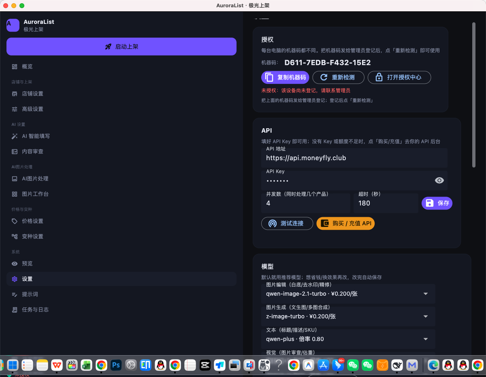

---

## 第 6 轮：固定模型 + 设置再简化 + 视频模块核查（2026-11-17）

### 用户要求 → 处理

| # | 要求 | 处理 |
|---|---|---|
| 27 | 固定模型，不让客户选择 | 新增 `services.FIXED_MODELS`：文本 `qwen-plus`、视觉 `qwen3-vl-plus`、图片编辑 `qwen-image-2.1-turbo`、图片生成 `z-image-turbo`；`model_of()` 忽略配置；设置页只显示模型名（无下拉、无「恢复推荐」）；删掉 `image_gen_model` / `model_*` 配置项与旧的下拉逻辑 |
| 28 | 去掉「授权中心」按钮（管理员才看） | 已删除该按钮及 `license_url` 配置项，设置页只剩「复制机器码 / 重新检测」 |
| 29 | API 不显示地址，只显示 token | 设置 API 卡只保留 API Key 输入（可显隐）+ 并发/超时 + 测试连接 + 购买/充值；API 地址固定为 `https://api.moneyfly.club`（内部常量，不展示） |
| 30 | 上传/视频模块是否有用 | 核查：**有用**（ffmpeg 合成实测 0.2s 出 12KB mp4；编辑器可上传主图视频；发布链路已接）。处理：设置页不再重复展示；视频开关收进「AI图片处理 → 主图视频」；删除从未被代码使用的 `upload_category_name`；`upload_full_cid` 移到「高级设置 → 上传」 |

### 真机模型验证（2026-11-17，使用真实 Key）

| 能力 | 固定模型 | 实测 |
|---|---|---|
| 文本（标题/描述/SKU） | `qwen-plus` | 200，标题生成 4.1s：`3 Ton Mini Spider Crane with 20m Boom, Tracked Electric for CAT` |
| 视觉（审查/估重） | `qwen3-vl-plus` | 200，3.4s，正确识别图片 |
| 图片编辑（白底/去水印/翻译/多图） | `qwen-image-2.1-turbo` | 200，9.4~12.8s；中文提示词「翻译图中文字、保持排版」返回可访问图片（`132.226.1.44:8099`） |
| 图片生成（文生图主图） | `z-image-turbo` | 200，6.1s，返回 1024 图 |
| 对比：`qwen-image-3.0` | 未固定 | 200 但 **43.3s/张**、¥0.3，故不用于默认生成 |

> 结论：中文提示词可直接用；图片编辑固定用 2.1-turbo（快、¥0.2），生成用 z-image-turbo（6s、¥0.2）。

### 回归

- `tools/verify_issues.py`：**176/176 通过**（新增固定模型 3 项、设置清理 4 项）
- `tools/button_audit.py`：305 个回调，仍只剩历史 FilePicker 假错
- 截图：设置页（机器码 / 仅 Token / 固定模型）

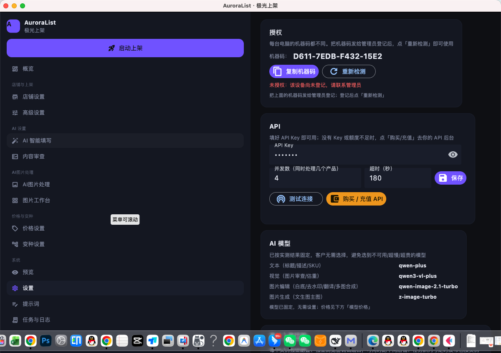

---

## 第 7 轮：服务器授权对接完成（2026-11-17）

### 服务器访问

- VPS：`132.226.1.44`（Debian arm64，宝塔面板 `https://132.226.1.44:30632/...`）
- **SSH 密码 `Sikeming01@` / `Sikeming001@` 均被拒绝**（`Permission denied`），但服务器的 `sshd_config` 明确允许 root 密码登录；
  说明密码与服务器实际 root 密码不一致（或已被改）。**SSH 公钥登录成功**（`~/.ssh/id_ed25519`），已用 key 完成排查。
- 宝塔面板账号 `moneyfly/120423mm` 能通过 `/login` 返回“登录成功”，但面板 SPA 无会话 cookie，内部 API 报“权限认证失败”，未使用面板改任何配置。
- 建议：关闭 SSH 密码登录（仅保留 key）、装 fail2ban；`lastb` 显示大量境外 IP 在爆破 root。

### 授权后台（license.moneyfly.club）现状

- 应用：PHP，代码 `/www/server/ae-license`，SQLite `/www/server/ae-license/storage/license.sqlite`
- 表 `licenses.identity TEXT NOT NULL UNIQUE` → **同一设备 ID 只能有一条授权，天然防重复**
- 路由：`POST /api/v1/license/verify`，只接受 `client_type` = `local` / `shop`
- 授权成功返回 ECDSA P-256 凭证：`voucher = b64url(identity|expiry|issued|client_type)`、`signature = b64url(raw r||s)`
- 管理后台可“一键登记设备”（`page_user_register`）与手动新增/续期/吊销

### 本轮客户端改动

| 项 | 改动 |
|---|---|
| 机器码格式 | 改为后台现有格式 `XXXXXXXX-XXXXXXXX`（实测库里 37 条老授权都是这个格式） |
| client_type | 由 `ae-publisher` 改为 `local`（后台只认 local/shop） |
| 兼容多种登记 | verify 依次尝试 `8-8` → 无横线 → 完整哈希；管理员登记哪种格式都能匹配 |
| 旧版授权迁移 | 设置页新增「旧版授权 ID（可选）」：老客户把老软件里的设备授权 ID 粘进来即可继续用原授权 |
| 凭证验签 | 新增 ECDSA 验签（内置服务器 public.pem，可用 `license_public_key` 覆盖）；伪造/篡改凭证直接判定未授权 |
| 实测登记 | 已为开发机 `D6117EDB-F43215E2` 建一条授权（到期 2027-11-17，备注“Mac-开发测试”），客户端实测 `authorized=true` + 凭证验签通过；重复插入被 `UNIQUE` 拒绝 |

### 仍需注意

- 老客户的授权 ID 是**旧算法**生成的（如 `53AB6DB5-CD59354F`），新客户端算法不同：
  - 升级时在「旧版授权 ID」里粘贴老 ID，可无缝继续；
  - 或由管理员用新机器码重新登记（一人一条，不会重复）。
- 若希望完全自动读取老授权，需要逆向旧客户端 `local_license.pyd` 的记录格式（已拿到旧客户端 recon 资料，后续可做）。

### 回归

- `tools/verify_issues.py`：**182/182 通过**（新增凭证验签 4 项、旧 ID 优先 1 项、旧 ID 输入框 1 项）
- 真实链路：本机机器码 `D6117EDB-F43215E2` → 后台 `authorized=true` → 凭证验签通过 → 设置页显示「授权有效 / 到期 2027-11-17」

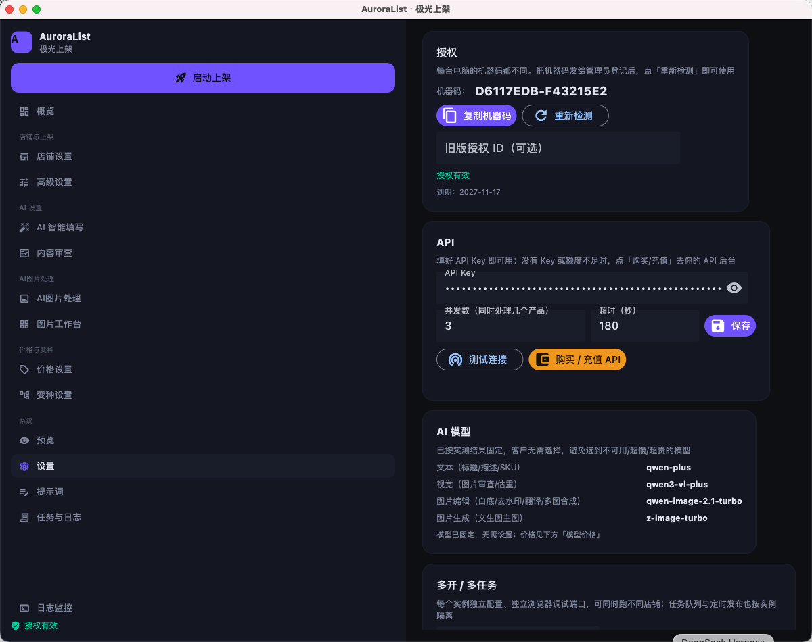

---

## 第 8 轮：删除预览页 / 去重 / 模板持久化 / 清理与卡死检查（2026-11-17）

### 用户反馈 → 处理

| # | 反馈 | 处理 |
|---|---|---|
| 31 | 预览列表没用 | **删除整个「预览」页**（导航 + 页面 + 执行逻辑），页面索引由 13 → 12 |
| 32 | 任务与日志里有版本更新等重复功能 | 日志页移除「检查更新」「生成主图视频」；版本只保留在「设置 → 版本更新」，并显示当前版本号 v0.2.0 |
| 33 | 其他重复入口 | ① 店铺页的「图片空间」卡删除（清理入口统一到图片工作台）② 概览移除「测试连接/一键自检」（设置里保留）③ 水印位置/透明度收进「高级设置 → 水印」卡，AI图片处理不再重复 |
| 34 | 保存模板到本地会导致软件重启 | 定位到模板库结构不一致：快速保存写 **list**、模板库按 **dict** 读，点「模板库」会 `lib.items()` 崩。统一为 `{name: record}` 并兼容旧 list；同时加 UI 更新锁、原子写配置、崩溃日志（见下） |
| 35 | 选过的模板下次打开还要重选 | ① 启动时 `_on_shop_change` 不再误清模板（只有真的换店铺才清）② 模板参数改为 **店小秘 API 读取**（不用打开浏览器）③ 已选模板在重启后直接显示（真机截图验证） |
| 36 | 选模板后不需要重新打开店小秘 | 新增 `DianxiaomiClient.template_snapshot()`：从 `/api/smtProduct/edit.json` 读类目/运费/重量/尺寸/属性/说明书；`_read_template` 优先 API，只有已连接的浏览器才兜底，**不再主动启动浏览器** |
| 37 | 图片空间清理不起作用 | 根因：店小秘「自动清理未引用图片」接口返回 **功能暂未开放**，原默认模式必然失败；且 30 天过滤对当天图片结果为 0。改为：扫描 → 勾选删除（`delPic`，实测可用）/ 按时间删除（`deleteBySearchCondition`，实测 `deleteCount` 可用）；界面显示图片/ PDF 数量并提示「天数改 0」 |

### 稳定性修复（重启/卡死专项）

- 所有 `page.update()` 统一走 `_safe_update()`：**串行锁 + 异常写 error.log**，避免后台线程并发更新导致 Flet 断连/重连（看起来像重启）
- 页面构建期间禁止中途 update（`_building_page`），避免半成品页面与协议错乱
- `AppConfig.save` 改为**原子写**（tmp → replace）并保留 `.bak`；配置损坏时自动读备份，避免重启后配置丢失
- 安装 `sys.excepthook` / `threading.excepthook`，异常写入 `配置目录/error.log`，不再“无声重启”
- 删除死代码：`_check_dxm_login/_fetch_products/_dry_run/_confirm_publish/_publish/_real_save/_show_albums/_open_template_dialog`
- 阻塞 UI 的操作全部放后台：模板选择/读取、模板库应用、清理扫描/删除、价格/模型加载、视频、上传等
- Cookie 状态显示不再连 CDP（避免打开页面卡 3~10 秒），CDP 只在真正取 Cookie 时用

### 真机验证

- 模板：首页显示已选模板 → 关闭软件 → 重开仍是该模板（截图）
- 模板参数：API 读取成功（类目/运费/重量/尺寸/26 项属性/说明书）
- 图片空间：1515 张图片 / 62 PDF；30 天前 0 张；**上传 1 张测试图 → 删除成功 → 数量回到 1515**（说明删除接口与清理逻辑可用）
- 清理对话框：默认提示“没有符合条件的图片（可把天数改成 0）”，不再一进来就调用不可用接口

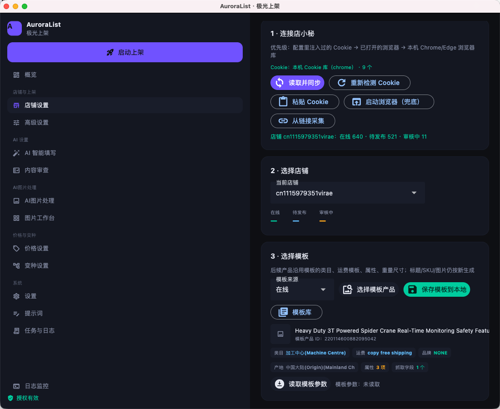

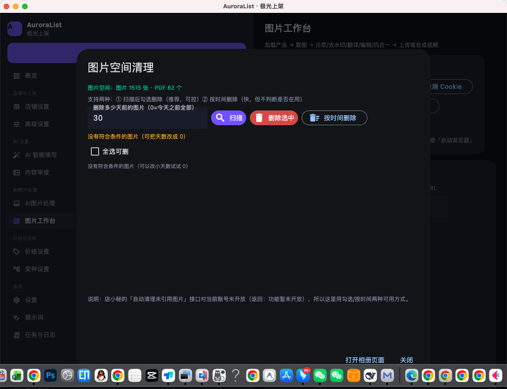

---

## 第 9 轮：暂停隐患排除 / 采集删除 / 模板库解释（2026-11-17）

### 1. 从链接采集：实测不可用，已删除

| 测试 | 结果 |
|---|---|
| Alibaba 商品页（真实链接） | 0.6 秒返回，标题 0、图片 0、`ok=False` |
| 1688 商品页 | 0.1 秒返回，标题 0、图片 0 |

原因：1688/Alibaba 都是 JS + 反爬，纯 `requests` 拿不到 `og:title/og:image`；原来的弹窗也没有走已连接浏览器的 `collect_via_cdp`；「加入队列」只是放进内存列表，没有真正进任务队列。  
处理：**删除按钮 + 弹窗 + `services/collector.py`**，避免用户点了一个永远不会成功的功能。

### 2. 运行中可能“暂停/卡死”的隐患（本轮排查）

| 隐患 | 老软件怎么处理 | 本轮处理 |
|---|---|---|
| macOS 读 Chrome Cookie 可能弹 Keychain，阻塞 UI | 老软件用独立服务/日志进程，UI 不直接做重活 | 页面显示**不再读本机 Cookie 库**；只有点「重新检测」才在后台线程读；启动检测也放后台 |
| 启动时同步校验授权，服务器慢就卡 10 秒 | 老软件启动服务单独跑，UI 显示状态 | 授权校验后台化 + 12 小时本地缓存；没缓存时提示“正在检测”，不再阻塞界面 |
| 模板选择/读取/应用是网络或 Playwright 操作 | 老软件日志监控线程 + 服务进程 | 模板列表、模板参数读取（改走 API）、应用模板全部后台线程 |
| 图片空间清理扫描/删除 | 老软件有独立任务/日志 | 扫描与删除均后台线程；界面先显示占用 |
| 日志事件过多，每条都重建 DataTable | 老软件日志有刷新线程/批量渲染 | `_refresh_log_table` 0.5 秒合并刷新；日志表只保留最近 300 行 |
| 多线程同时 `page.update()`，Flet 断连/重连 | 老软件用日志线程统一刷新 | 全部走 `_safe_update()` 串行锁；异常写 `error.log` |
| 页面构建中途 update，半成品控件报错 | — | `_building_page` 标记，构建期间跳过 update |
| 写配置时断电/被杀，配置损坏后“重启丢设置” | — | 原子写 + `.bak` + 启动自动读备份 |
| ffmpeg 生成视频卡住 | 老软件有任务超时/终止 | ffmpeg 统一 600 秒超时；探测 10 秒超时 |
| 长任务长时间没有输出，看起来像暂停 | 老软件日志显示 running/error/completed + 终止按钮 | 新增「状态：运行中/空闲/已请求停止」；每 15 秒心跳日志；新增「停止任务」按钮 |
| 重复点启动/队列并发跑 | — | `_running` 单任务锁：已有任务时拒绝第二次启动/队列 |

### 3. 老软件日志参考

老软件 `LogMonitorTab` 的行为（recon 文档里的符号）：`_set_status`、`_update_status_running/error/completed`、`_start_log_file_monitor`、`_start_ui_refresh_thread`、`_on_terminate_click`、自动滚动、日志文件监控。  
对应到本软件：

- 状态：`状态：空闲 / 运行中… / 已请求停止 / 完成：成功 x / 失败 y`
- 心跳：每 15 秒写一条「运行中：已完成 x/y · 当前 …」
- 终止：日志页「停止任务」，当前产品结束后停
- 日志内容仍为：时间 / 级别 / 内容；进度条显示步骤、耗时、累计费用

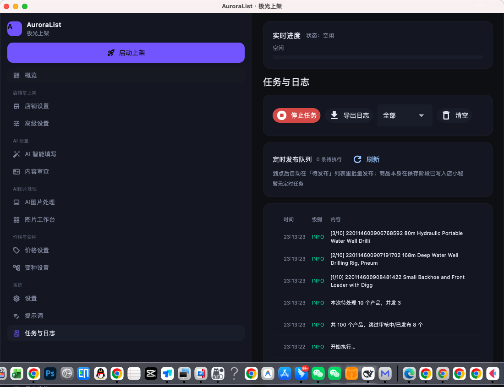

### 4. 为什么保存到本地后模板库没有？

两个原因，均已修：

1. **结构不一致**：快速保存写的是 list，模板库按 dict 读，点开就 `lib.items()` 崩（表现像重启/空白）。
   统一为 `{name: record}`，并自动兼容旧 list。
2. **空模板也会保存**：没读取参数时保存，会生成空记录，看起来“没有内容”。
   现在保存前检查 `template_snapshot.fields/attributes`，为空直接提示「请先选模板产品并读取参数」，不再写空记录。

真机验证：保存后打开模板库，能看到刚保存的模板（截图）。

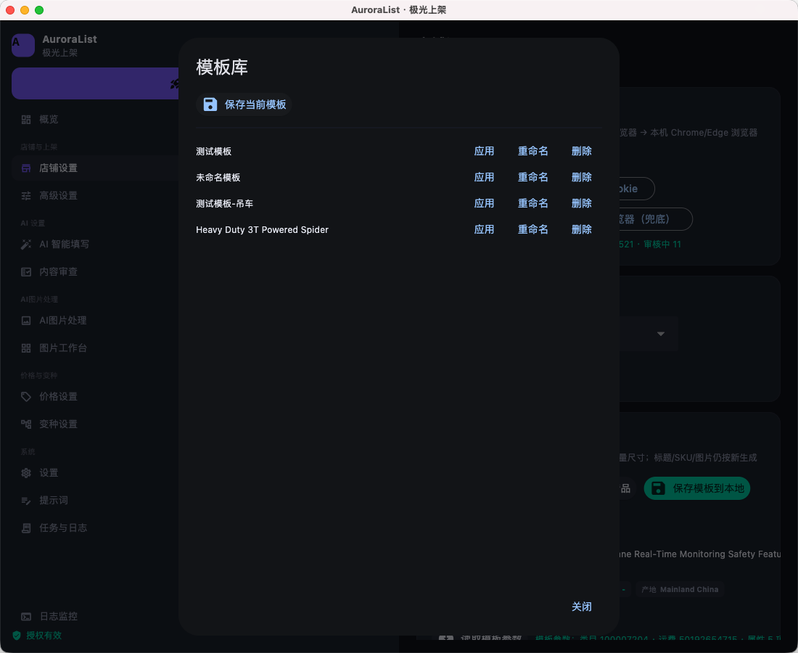

---

## 第 10 轮：新电脑安装 / 打包 / 更新 / 运行逻辑审计（2026-11-17）

### 一、新电脑要装什么（直接结论）

| 必须 | 说明 |
|---|---|
| Windows 10/11 64 位 | 不支持 Win7/32 位 |
| Chrome 或 Edge | Win10/11 有 Edge 即可；Chrome 更稳。用于店小秘登录/Cookie/CDP |
| 网络 | 授权、API、店小秘三个域名 |
| 授权 + API Key + 店小秘登录态 | **缺一不可**（见下） |

| 不需要 | 说明 |
|---|---|
| Python / Node | 安装包已内置（PyInstaller + Flet） |
| 管理员权限 | 安装包默认装用户目录 |
| VC++ 运行库 | Win10/11 自带；极老系统才需要 |
| ffmpeg | 只有主图视频需要，可选 |

**装好不能“直接上架”**：程序能启动，但新机器码必须由管理员登记授权；还要填 API Key、登录店小秘、选一次模板。完整步骤见 [docs/INSTALL.md](INSTALL.md)。

### 二、本轮修掉的安装/运行问题

| # | 问题 | 修复 |
|---|---|---|
| 1 | `run()` 用相对 `assets_dir="assets"`，快捷方式从别的目录启动会找不到图标/水印资源 | 打包后从 `_MEIPASS/assets` 解析；开发环境从项目根解析 |
| 2 | PyInstaller 只收 `browser_cookie3/Crypto`，Playwright 是动态导入，打包后可能缺 driver | spec 增加 `collect_all("playwright")` + hiddenimports（`playwright.sync_api`、`_impl._driver`） |
| 3 | 只有便携 zip，没有安装包 | 新增 `installer.iss`（Inno Setup 6，按用户安装、开始菜单/可选桌面快捷方式、卸载） |
| 4 | CI 只出 zip | GitHub Actions 增加 Inno Setup 构建，Release 同时上传 zip + Setup |
| 5 | 更新接口字段是 `latestVersion/downloadUrl`，代码只读 `version/latest_version`，永远显示“已是最新” | 兼容 camelCase；`hasUpdate` 也参考服务端字段 |
| 6 | 检查到更新后只能看，不能安装 | 设置里增加更新弹窗：更新说明 + 下载 + SHA256 校验 + 启动安装程序 |
| 7 | 版本号 0.2.0 比后台旧版 1.1.5.3 低，修好解析后会误提示“升级到旧版” | 新客户端版本统一为 **1.2.0**；后台需把 latest 配到 >1.2.0 才会提示 |
| 8 | 授权服务器暂时断网时，`_check_license` 把缓存清掉，之后无法启动 | 网络错误保留缓存；离线宽限 72 小时；明确未授权才清 |
| 9 | 定时发布看起来像“关掉软件也会执行” | 任务页明确提示：**定时任务需要软件保持运行** |
| 10 | 视频找不到 ffmpeg 时只说“请安装” | 支持 `AuroraList.exe` 同目录 / `_internal\assets\bin\ffmpeg.exe` / PATH 三种放置；安装文档写清 |

### 三、和老软件对比：还需要优化的点（按优先级）

| 优先级 | 项 | 老软件对应 | 现状/建议 |
|---|---|---|---|
| P0 | 新电脑授权流程 | `local_license/shop_license` | 现在只能“复制机器码→管理员登记”；建议做自助登记页/兑换码，减少客服 |
| P0 | 定时任务需软件常开 | `startup_service`/服务化 | 建议加开机自启 + 最小化到托盘；否则客户关机就漏发 |
| P1 | 店铺授权模式 | `utils/shop_license` | 当前客户端固定 `client_type=local`，后台支持 shop；有店铺授权客户需补 |
| P1 | 全局代理 | `utils/proxy_config` | 现在只有 API 走代理；授权/店小秘/浏览器没走；跨境网络差时是硬伤 |
| P1 | 日志上传 | `utils/log_uploader` + 后台 app_logs | 现在只写本地 `error.log`；建议一键上传日志，客服排障更快 |
| P1 | 安装包签名 | 老软件也可能没签 | 未签名会触发 SmartScreen；正式售卖建议买代码签名证书 |
| P2 | 店铺商品类目/运费模板名称 | `data_extractor` | 模板 API 拿到的是 categoryId/freightTemplateId；对空白新品可能选不中，建议补名称解析 |
| P2 | API Key/Cookie 明文 | `utils/cookie_cache` | 现在存 `config.json` 明文；建议 DPAPI/Keychain 加密 |
| P2 | 启动画面/更新服务 | `splash_screen/startup_service` | 可加启动 splash + 启动时自动检查更新 |
| P2 | 自动更新下载地址 | `update_installer` | 后台 `downloadUrl` 目前是 null；配好后客户端才能一键更新 |
| P3 | Windows 真机验收 | — | 本机是 macOS，CI 只保证能打包；需要在干净 Win10/11 上跑一遍首次安装/授权/Cookie/上架 |
| P3 | 自动化选择器抗改版 | `product_edit_service` | 店小秘前端改版会导致定位失败；建议关键选择器多备选 + 失败截图 |

### 四、安装文档

新增 [docs/INSTALL.md](INSTALL.md)：依赖表、安装包/便携包、首次设置、ffmpeg 放置、数据目录、卸载、已知限制、故障排查。

### 五、回归

- `tools/verify_issues.py`：**199/199 通过**（新增更新字段解析、assets 路径）
- `button_audit`：0 新增错误
- `CURRENT=1.2.0`；后台当前 latest 1.1.5.3，因此不会误提示升级

---

## 第 11 轮：日志跟随 / 运行错误定位（2026-11-17）

### 1. 日志「总是跳到最新」

- 任务与日志页新增勾选「**总是跳到最新日志**」，默认勾选
- 勾选：每次新日志都滚到最底部，不需要滚鼠标
- 取消勾选：记录当前滚动位置；新日志追加时保持你正在看的位置（鼠标停在哪条就停在哪条附近）
- 表格顺序改为**旧→新（最新在最下面）**；超过 300 行只显示最近 300 行
- 表格只显示**本次运行**的日志；上次运行的日志保留在 `logs/app.log`，点「打开日志文件」查看
- 勾选状态保存到 `config.json` 的 `log_auto_follow`，重启保持

### 2. 刚才运行报错的原因

错误日志原文：

```
引导弹窗异常: 'App' object has no attribute 'tpl_preview_box'
```

原因：首次引导弹窗（`_maybe_wizard`）在启动时就要用 `tpl_preview_box`，但该控件原来只在「店铺设置」页里创建；启动时先弹引导，就抛 AttributeError，引导打不开/界面异常。

修复：

- `App.__init__` 在弹引导前先创建 `tpl_preview_box` / `tpl_snapshot_text`
- `_p_store` 改为**复用**这两个控件，不再重新创建（否则引导里引用的是旧控件）
- 已有店铺或 API Key 的老用户自动标记 `onboarded=True`，不再重复弹首次引导
- 新增测试：首次引导弹窗不崩

### 3. 日志持久化（以后报错不用猜）

- 所有 `_log` 同时写 `%APPDATA%\AuroraList\logs\app.log`（macOS：`~/Library/Application Support/AuroraList/logs/app.log`）
- 2MB 自动轮转（`app.1`）
- 启动时读回最近 300 行，上次运行出错的内容还在
- 日志页新增「打开日志文件」按钮，用户可直接把文件发给客服
- 保留 `error.log` 记录未捕获异常

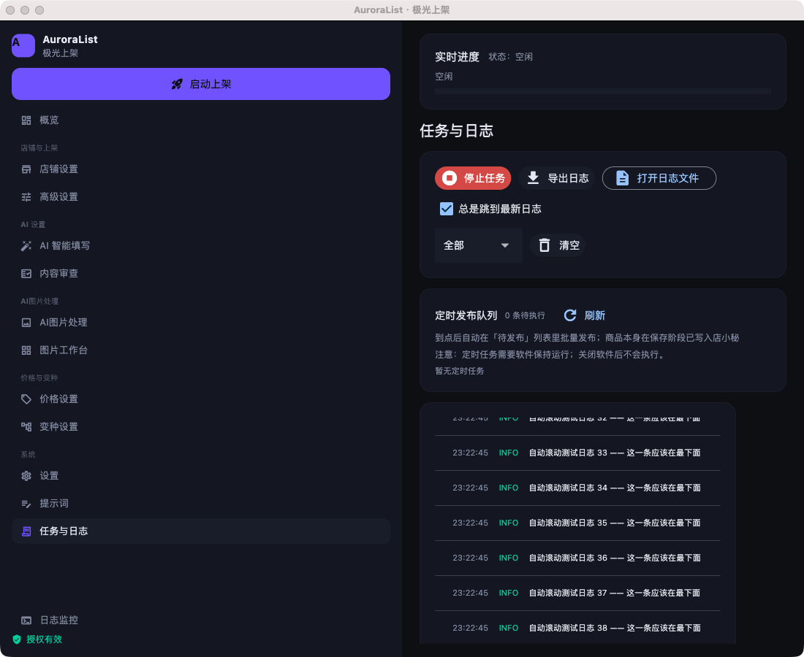

---

## 第 12 轮：模板属性纠正 / 审核产品跳过 / 保存与速度（2026-11-17）

### 1. 模板语义纠正（按客户要求）

- 模板只作为**类目 / 运费 / 重量 / 尺寸 / 模板字段值**的参考
- **不再复制模板产品的自定义属性**到新产品，避免属性重复
  - `Publisher._apply_template`：`template_attributes` 置空，不再生成 `attributes_map`
  - `apply_and_save`：`attrs = []`，不追加模板属性
  - `apply_template_fields` 同步修正
- 模板仍保留属性列表用于预览/参考，不会写入新产品

### 2. 审核中的产品不再编辑

- `DianxiaomiClient.pending_products()` 过滤 `auditing/onSelling/published/online`
- `Publisher.run()` 开始前调用 `product_state(id)` 查详情状态：
  - 详情状态 `auditing` 或 `errMsg` 含 `PRODUCT_IN_AUDIT_PENDING` → 直接返回“已跳过”，不跑 AI、不开编辑器
- 队列入队/队列执行同样过滤
- 用户指出的 `220114600906768592` 当前详情状态为 `auditing`，现在任何入口都会跳过

### 3. 保存到待发布：真实链路修复

实测保存失败的原因有 4 个，逐一修：

| 原因 | 修复 |
|---|---|
| 没有 CDP 浏览器，保存直接报“未连接浏览器” | 启动流水线前自动 `ensure_browser`，并把本机 Cookie 注入独立调试浏览器 |
| 页面有 3 个「更新」按钮，代码点了第一个（可能是隐藏/无效） | 只点**可见且可用**的「更新/保存」 |
| 保存接口 HTTP 200 但 `code=-1`（如审核中/校验失败）被当成成功 | 解析 `add.json` 的 `code/msg`，非 0 一律失败并显示站点原因 |
| 审核中产品混在 `editingRequired` 列表 | 列表过滤 + 详情预检双保险 |

**实测**：`apply_and_save` 直接保存一个正常产品 34.5s，返回 `保存接口 /api/smtProduct/add.json HTTP 200`；完整快速模式产品（标题/详情 + 主图白底去水印 + 保存）128.7s，成功。

### 4. 速度优化（仿老软件图像流水线）

老软件 `image_task_plan` / `image_lab_view` 的核心：
- 先构建图片任务计划，再按步骤执行：**去水印 → 翻译 → 白底 → 通用编辑**
- 每一步有独立开关/范围；不启用就不产生 AI 调用
- 任务批量提交、并发执行；图片处理顺序固定，UI 与执行同一口径
- 日志监控用队列 + 单刷新线程批量渲染

对应改造：

| 优化 | 效果 |
|---|---|
| `ai_image_enable` 总开关 | 一键关掉所有 AI 图片步骤 |
| 每个图片步骤独立开关（主图/详情/SKU/翻译/编辑/营销/视频/水印/四合一/审查/估重） | 不会再出现“没勾也跑”的隐式调用 |
| **一键快速模式** | 关闭审查/估重/营销/翻译/视频/四合一，只保留白底、去水印、SKU白底 + 标题/详情 |
| `image_concurrency`（默认 4） | 同一产品多图并行调用（主图/详情/SKU/上传/转存/简单规则） |
| 产品并发 `concurrency` | 多产品并行；快速模式设为 ≥4 |
| 自动浏览器 + Cookie 注入 | 不再因为没登录而白跑几分钟 AI |
| 审核预检 | 审核产品 1 次详情查询即跳过，不再浪费 4 分钟 |
| 日志心跳/耗时 | 每 15 秒显示已完成/当前产品 |

### 5. 真实性能对比（本机）

| 场景 | 结果 |
|---|---|
| 修复前（无浏览器 + 保存点错按钮 + 审核产品） | 3 个产品跑了 4 分 54 秒，最后全部未保存 |
| 修复后（直接保存） | 34.5s，保存成功 |
| 修复后（快速模式完整处理一个产品） | 128.7s，保存成功 |

### 6. 待继续（不影响本轮）

- AI 图片处理结果回写到店小秘商品主图/详情图的 UI 选择器仍需继续完善（目前图片链路主要服务图片工作台/相册；保存接口已验证）
- P2/P3：全局代理、店铺授权、日志上传、代码签名、Windows 真机验收
